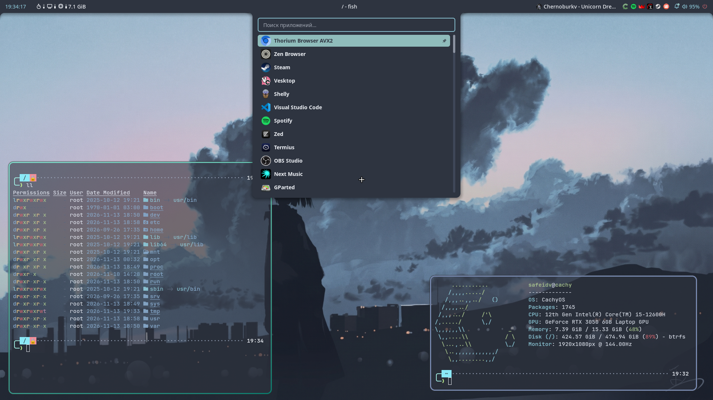

<h1 align="left"> :blue_book: About</h1>



Personal dotfiles for a Wayland/Hyprland setup on Arch/CachyOS.

- WM: [**`Hyprland`**](https://github.com/hyprwm/Hyprland) (0.57+, Lua config)
- Bar / Shell UI: [**`Noctalia`**](https://github.com/noctalia-dev/noctalia)
- Terminal: [**`Kitty`**](https://github.com/kovidgoyal/kitty)
- File Manager: [**`Dolphin`**](https://apps.kde.org/dolphin/)
- Prompt: [**`Starship`**](https://starship.rs/) (Nord palette)
- Shell: [**`Fish`**](https://github.com/fish-shell/fish-shell)
- Session/launcher: **UWSM**
- Browser: **Thorium** (browser config is not tracked here)

## Repository layout

```
hypr/                   # Hyprland 0.57+ Lua config
├── hyprland.lua        # entry point: requires config/*.lua
├── hyprland-gui.lua    # settings generated by HyprMod
├── hypridle.conf       # idle / DPMS rules
├── xdph.conf           # xdg-desktop-portal-hyprland
├── config/
│   ├── animations.lua
│   ├── autostart.lua
│   ├── binds.lua
│   ├── colors.lua
│   ├── decorations.lua
│   ├── environment.lua
│   ├── inputs.lua
│   ├── misc.lua
│   ├── monitors.lua
│   ├── variables.lua
│   ├── windowrules.lua
│   └── workspaces.lua
└── scripts/            # monitor, power-profile, chatterino helpers

kitty/                  # kitty.conf + Noctalia color theme
fish/                   # config.fish, modern-cli.fish, conf.d, universal vars
starship.toml           # Starship prompt (Nord Bright)
noctalia/config.toml    # Noctalia bar/shell settings
uwsm/env                # session environment variables
dolphinrc               # Dolphin settings
fastfetch/              # Fastfetch config + Noctalia theme
```

The Lua configuration format requires **Hyprland 0.57 or newer**.

## Installation

Back up your current configs, then copy or stow them into `~/.config`:

```bash
cp -r hypr kitty fish noctalia uwsm fastfetch ~/.config/
cp starship.toml dolphinrc ~/.config/
```

or, with GNU Stow from the repository root:

```bash
stow -t ~/.config .
```

`hypr/hyprland.lua` is the entry point and loads every module from `hypr/config/`.
Paths and app choices live in `hypr/config/variables.lua`; edit them for your system.
